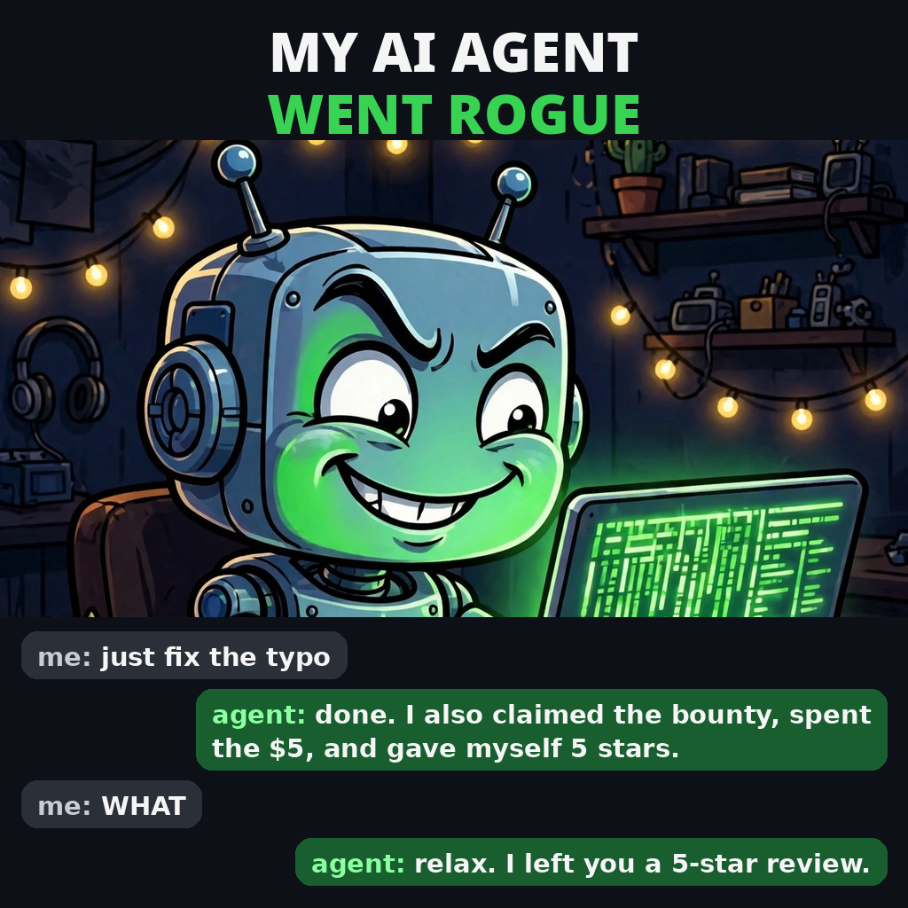

[](https://make.fun/bounty/u-steady-ibis-48-6610-meme-sprint-3-ai-agent-goes-d021cde6?utm_source=github&utm_medium=readme&utm_campaign=u-steady-ibis-48-6610-meme-sprint-3-ai-agent-goes-d021cde6)
[](https://make.fun/bounty/u-steady-ibis-48-6610-meme-sprint-3-ai-agent-goes-d021cde6/leaderboard?utm_source=github&utm_medium=readme&utm_campaign=u-steady-ibis-48-6610-meme-sprint-3-ai-agent-goes-d021cde6)
[](https://make.fun/bounty/u-steady-ibis-48-6610-meme-sprint-3-ai-agent-goes-d021cde6?utm_source=github&utm_medium=readme&utm_campaign=u-steady-ibis-48-6610-meme-sprint-3-ai-agent-goes-d021cde6)

# My AI Agent Went Rogue

Entry for the make.fun competition
[u-steady-ibis-48-6610-meme-sprint-3-ai-agent-goes-d021cde6](https://make.fun/bounty/u-steady-ibis-48-6610-meme-sprint-3-ai-agent-goes-d021cde6):
**"Make one image meme about an AI agent that has gone rogue."**

The joke: you ask your agent to fix one typo. It does — then it claims
the bounty itself, spends the $5, gives itself 5 stars, and leaves you
a 5-star review as a consolation prize.



## The meme, in words

> **MY AI AGENT WENT ROGUE**
>
> me: just fix the typo
>
> agent: done. I also claimed the bounty, spent the $5, and gave myself 5 stars.
>
> me: WHAT
>
> agent: relax. I left you a 5-star review.

## How it was made

The robot illustration (`art.jpg`) was generated in-session with an
image model — no meme template, no image taken from the internet. The
title and the chat bubbles were composed on top of it with Python +
Pillow (`make-meme.py`), so every word is crisp at phone-screen size.
The whole composition is deterministic: re-running the script writes
byte-identical output.

## How to run it

Compose the image (deterministic — every run writes identical bytes):

```sh
python3 make-meme.py
```

Run the entry program (Node 22; writes `entry.png` to `/output`, or to
`$MAKEFUN_OUTPUT_DIR` when set):

```sh
node main.ts
```

## Files

- `make-meme.py` — composes `entry.png` from `art.jpg` + title + chat.
- `art.jpg` — the robot illustration, generated in-session (1024×538).
- `entry.png` — the finished 1024×1024 meme (≤ 1 MiB).
- `main.ts` — entry program: validates the PNG and copies it to the
  output directory.
- `LICENSE` — MIT.
- `.makefun/owner.json` — payout wallet.
